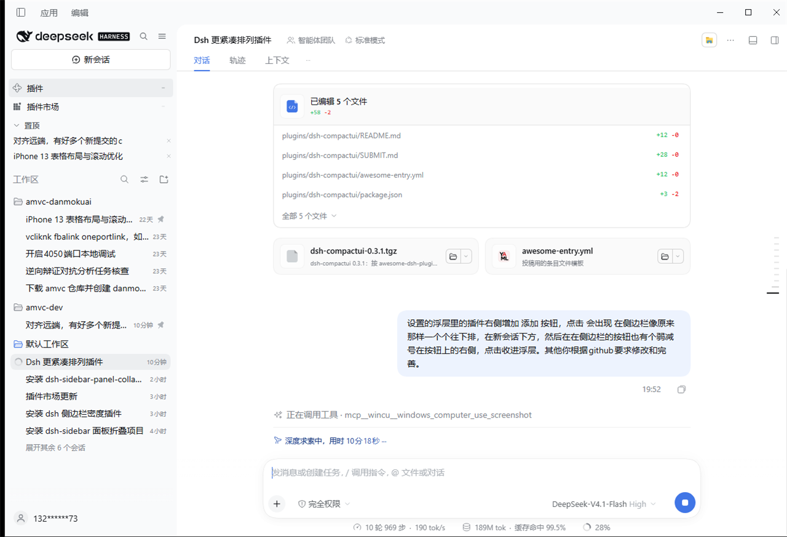
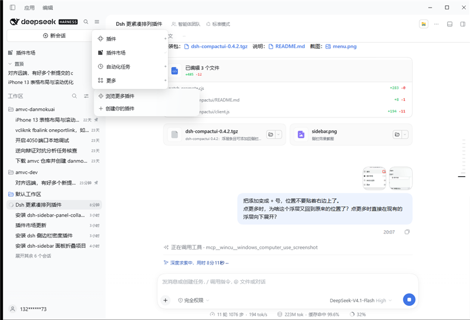

# dsh-compactui

把 DeepSeek Harness（DSH）左侧栏改成 Codex 风格的紧凑布局：顶部大 Logo + 内联搜索，中间「置顶 + 工作区」，底部一个浮层收纳全部插件类入口。

仓库：<https://github.com/ifengz/dsh-compactUI>



## 功能

| 区域 | 行为 |
| --- | --- |
| 品牌行 | 品牌行拔高到 56px，Logo 放大到 26px，名称 16px/600；右侧是「搜索」和「菜单」两个图标按钮 |
| 内联搜索 | 点放大镜后，搜索框占据左侧 Logo 的位置（Logo 与按钮暂时隐藏），边打边过滤侧栏会话；回车打开第一条命中项，Esc 或 ✕ 退出并复原 |
| 新聊天 | 「新会话」按钮改成贴左、34px 高的细按钮 |
| 置顶 | 可折叠区块，列出置顶会话；每行右侧 ✕ 是「取消置顶」，点击条目会打开对应会话 |
| 工作区 | 保持宿主原样（项目分组 + 会话行） |
| 底部菜单 | 插件 / 插件市场 / 自动化任务 / 更多 等入口从侧栏竖排移进一个浮层菜单，浮层贴着菜单按钮弹出；每条右侧有一个 ＋ |
| 二级菜单 | 像「更多」这种本身会弹子菜单的入口，点开后子菜单直接贴在浮层下方展开（不再弹回宿主原来的位置），主浮层保持打开 |
| 添加入口 | 浮层里点某条的 ＋，该入口立刻以普通竖排行出现在侧栏「新会话」正下方，位置与原生面板行一致；已添加的条目在浮层里显示为勾号 |
| 收进浮层 | 侧栏里这些行右侧有一个弱化减号（`−`，默认 35% 透明度，悬停变实），点它把入口收回浮层 |



关键点：**置顶列表持久化在 localStorage**。DSH 在项目折叠时会把该项目的会话行从 DOM 卸载，纯靠扫描 DOM 的实现会在折叠后丢失置顶项；本插件把置顶会话记录在本地，折叠项目后条目仍在，点条目会自动展开对应项目再打开会话。

侧栏常驻的导航行同样持久化在 `localStorage["dsh-compactui:promoted"]`，重启后仍在；宿主里新增或删除插件时，浮层每次打开都重新读取宿主导航，所以新插件会自动出现在浮层里、可以直接「添加」。

## 实现方式

全部改动在浏览器端（`client.js`），宿主侧 `index.js` 只是一个空 `apply()` 占位，用来让 cordis 认作合法插件。

1. **样式注入**：`<style id="dsh-compactui:style">` 一次性注入，选择器统一写成 `[class*="_logoRow"]` 这类稳定片段。DSH 的 CSS Modules 类名带构建期哈希（`_logoRow_1abc2_3`），写死哈希的插件一升级就失效，所以这里只匹配局部片段。
2. **不移动宿主节点**：React 管理的 DOM 被搬走后，下次重渲染会把界面拆掉。因此原「面板导航」行用 CSS 隐藏，浮层里放**克隆按钮**，点击时按文案找回仍然活着的原按钮并 `.click()`，交给宿主自己的逻辑处理跳转。
3. **置顶持久化**：置顶会话记录成 `[{ "t": "会话标题" }]`，写入 `localStorage["dsh-compactui:pinned"]`。每次渲染先扫一遍 DOM 里活着的置顶行（`aria-label` 含「已置顶」）补写记录；宿主里被取消置顶的行会被移除记录。首次启动且本地列表为空时，会临时展开折叠的项目扫一遍再收回，保证已有置顶不丢。
4. **跟随重渲染**：`MutationObserver` + `requestAnimationFrame` 去抖，宿主重渲染后补齐自己的节点；`ctx.effect` 的 dispose 负责把注入的样式与节点全部移除。
5. **添加入口**：浮层与侧栏常驻行都是宿主原行的**克隆**，点击时按文案找回活的原行再 `.click()`；「添加 / 减号」只改 `localStorage["dsh-compactui:promoted"]` 里的文案列表，然后重建克隆节点，不动宿主 DOM。

## 兼容性

- 开发与验证环境：DSH 桌面版 **0.2.2-rc.1**（Windows）。
- 只作用于 Web/桌面渲染层（`dsh.client.platform = "web"`），不涉及服务端；CLI 与纯 API 使用不受影响。
- 依赖的是**类名局部片段**和 `aria-label` 文案（「搜索会话」「已置顶」「取消置顶」「置顶会话」）。宿主大改侧栏结构或改这些文案时需要跟着调整。
- 与其它改侧栏的插件可能互相覆盖（同一批 DOM、同一批 CSS 优先级）。已经用了同类侧栏插件的话，建议只留一个。

## 安装

从 npm（发布后）：

```bash
dsh plugin --profile web add dsh-compactui
```

从本地目录或压缩包：

```bash
dsh plugin --profile web add file:C:/path/to/dsh-compactui
dsh plugin --profile web add C:/path/to/dsh-compactui-0.3.0.tgz
```

装完后刷新页面（桌面版在 DevTools 里 `location.reload()`，或重启 DSH）。

## 卸载

```bash
dsh plugin --profile web remove dsh-compactui
```

卸载后侧栏立即回到原样；`localStorage` 里会留一条 `dsh-compactui:pinned`，需要的话手动清掉。

## 已知限制

- 置顶记录按**会话标题**匹配。会话改名后，旧记录不会自动跟随，需要重新置顶一次。
- 会话被彻底删除后，其置顶记录只能通过条目上的 ✕ 手动清除。
- 首次启动的「临时展开项目扫一遍」会让折叠的项目闪一下，这是为了让已有置顶在第一次就能显示出来。

## 目录结构

```
dsh-compactui/
├── index.js           # 宿主侧空插件（cordis 占位）
├── client.js          # 全部界面逻辑与样式
├── cordis.patch.yml   # 注册插件：- insert: [{ id: compactui, name: dsh-compactui }]
├── package.json       # dsh.bundle.patch + dsh.client.platform=web
├── sidebar.png        # 效果截图
└── README.md
```

## 收录到插件市场

按 [awesome-dsh-plugin 投稿规范](https://github.com/awesome-dsh-plugin/awesome-dsh-plugin/blob/main/contributing.md) 准备：

- `package.json` 已声明 `dsh.bundle.patch`（这是能被 `dsh plugin add` 安装的关键，只写 `dsh.client` 会被拒）。
- 仓库根有 `cordis.patch.yml`。
- 截图按规范放在包目录的 `screenshots.json`（1–8 张，相对路径）。
- 投稿 PR 只加一个文件 `data/plugins/<owner>__<repo>.yml`，模板见同目录 [`awesome-entry.yml`](awesome-entry.yml)。
- 仓库需加 `dsh-plugin` topic，且创建满 1 天。

细节与清单见 [`SUBMIT.md`](SUBMIT.md)。

## License

MIT
